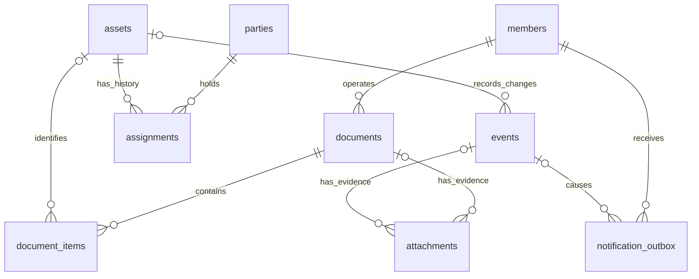

# 数据库模式设计

状态：依据[统一业务规则](business-rules.md)、[账号流程](account-design.md)和[逻辑模型](data-model.md)细化的第一版物理设计。已获用户授权，于 2026-10-17 应用[初始结构迁移](../database/migrations/202610170001_initial_schema.sql)：创建十一张表、约束、索引、只读视图和权限基础；账号、找回与审核通知接口已上线；存量建账 RPC 已随迁移 005 获授权上线，领入、分发、退回及编号打印单已获授权上线，迁移 006 已应用；附件存储及人工归档的迁移 008、私有桶与独立函数已获授权上线，真实用户操作和签字件归档待本人验收；其他设备操作和完整业务验收仍待完成。适用于不足一百件设备、约十名系统用户，保留单一单位、固定角色和统一库存。

迁移 009 已获授权应用，增加逐设备延期与当前临时分配的到期查询函数，不改变表结构，见[临时使用实施](temporary-use-implementation.md)。

迁移 010 已获授权应用，扩展保存与确认事务以支持转交及团队负责人交接，不改变表结构或既有权限，见[转交实施](transfers-implementation.md)。

## 1. 范围和共同约定

迁移 013 已本地实现，提供带原因、前后值、版本核对及请求去重的设备基本资料更正，仅新增公开和私有函数，不改变表结构、分配及原单，生产执行待授权，见[资料更正实施](asset-details-implementation.md)。

迁移 012 已获授权应用，增加管理员整单作废、追加更正说明和替代单关联；复用现有事件与抵消关系，仅扩展事件类型约束和单据读取，不增加表、列或触发器，原有数据和共享配置保留核对通过，见[单据处理实施](document-review-implementation.md)。

迁移 011 已获授权应用，新增故障与维修接口并保护交接日期顺序；复用现有设备及事件结构，不增加表、列或触发器，既有数据和共享配置保留核对通过，见[故障实施](asset-condition-implementation.md)。

业务表放在 `gear_2026` schema。另设不暴露给 Data API 的 `gear_private_2026`，仅放权限辅助和事务函数，不另建一套业务数据。应用统一从 `GEAR_DB_SCHEMA` 读取业务 schema，前端由发布流程注入运行配置；创建年份后缀固定，详见[命名与配置](schema-naming.md)。实际 schema 与桶名在实施时从项目配置核对，初始化保留共享项目已有对象、用户和设置。

共十一张表：八张核心记录表，三张设置、编号和通知辅助表。设备分类、品牌和位置使用简单字段；人员与团队共用名单表。当前不需要组织层级、分类字典、多仓库、审批流配置或分库分表。

| 表 | 用途 |
| --- | --- |
| `members` | 本应用的申请、审核和角色 |
| `parties` | 人员、团队及上游单位名单 |
| `assets` | 每件实物的身份和当前基本信息 |
| `documents` | 交接单表头、编号和归档状态 |
| `document_items` | 单据逐件明细和确认快照 |
| `assignments` | 使用分配的起止、负责人和期限 |
| `attachments` | 文件关联、上传、识别和核对信息 |
| `events` | 设备变化与操作审计 |
| `app_settings` | 单位抬头和少量业务设置 |
| `document_counters` | 每个业务日共用的单据流水 |
| `notification_outbox` | 日常邮件的待发和发送结果 |

- 主业务记录主键使用数据库生成的 `uuid`；事件使用递增 `bigint`，设置采用固定单行主键，编号计数器以业务日期为主键。事件编号及其他 `bigint` 在接口中作为十进制字符串传输。
- 成员、名单、设备、单据、明细、分配、附件、设置及通知保存 `created_at`、`updated_at`，类型为 `timestamptz`；计数器只需 `updated_at`，事件只有不可改写的 `recorded_at`。日期事实使用 `date`，历史未知日期允许为空。
- `timestamptz` 表示时间点，接口统一输出 UTC；业务日期统一按 `Asia/Shanghai` 计算，不依赖服务器或浏览器默认时区。
- 有限状态使用 `text` 加 `CHECK`；空白选填文本规范化为 `NULL`，名称等必填文本去除首尾空白后不得为空。外键默认 `RESTRICT`，特殊删除行为逐项说明。正文未标明可空的字段必填；草稿阶段和处理中的条件必填另按状态约束。
- 前端不直接修改业务表，写入通过固定用途的事务 RPC。设备、名单、成员及单据保留整型 `version`，从 1 开始递增，用于发现旧表单；版本不因更正而倒退。
- 关系、金额以外的固定字段使用普通列；`jsonb` 只承载打印快照、受控前后值、识别候选和简短通知参数，不作为任意修改记录的入口。本版没有金额核算字段。

## 2. 主要关系

图中省略了经办账号等重复外键，以及独立的设置和计数器。领入新设备的草稿明细暂时没有设备外键，确认后补齐；每个附件只归属一张单据或一条设备事件。

## 3. 系统成员和接收名单

### `members`

| 字段 | 类型与约束 | 含义 |
| --- | --- | --- |
| `id` | `uuid`，主键 | 设备簿内部成员标识，历史操作引用它 |
| `auth_user_id` | `uuid`，可空、唯一，引用 `auth.users.id` | 共享认证身份；外部删除身份时 `SET NULL`，保留成员和历史 |
| `display_name` | `text`，必填 | 操作账号的显示姓名 |
| `status` | `pending / active / rejected / disabled` | 本应用访问状态 |
| `role` | `admin / operator / viewer`，可空 | 仅 `active` 时非空，其他状态清空；原角色保留在审计中 |
| `party_id` | `uuid`，可空、唯一，引用 `parties` | 可选关联人员名单，只能关联个人 |
| `reviewed_by / reviewed_at / review_note` | 成员外键、时间点、文本，均可空 | 最近一次审核或停用处理 |
| `version` | 正整数 | 审核和角色修改的并发检查 |

邮箱、密码、邮箱验证状态以 Supabase Auth 为准，不复制密码、重置令牌或一套独立验证布尔值。审批和发送邮件时由受控函数取得当前身份资料；浏览器不能直接读取 `auth.users`。历史经办姓名另保存在单据和事件快照中。

不在共享 `auth.users` 安装自动注册成员的触发器。只有用户通过设备簿明确申请访问，才创建本应用的待审核成员；注册验证回调后和已有身份首次进入本应用时均可走此入口。未验证邮箱不能批准，重复申请不自动恢复拒绝或停用状态，首个公开注册者不会成为管理员。

首次管理员由部署者指定已验证身份初始化。审核、停用和角色变更先锁定设置单行，再读取最新成员状态，串行检查最后一个可用管理员；恢复停用时明确选择角色。此保护针对本应用操作，不能阻止其他系统删除共享身份；若因此失去管理员，由部署者走恢复流程，不增加跨应用删除钩子。

### `parties`

| 字段 | 类型与约束 | 含义 |
| --- | --- | --- |
| `id` | `uuid`，主键 | 稳定的接收或交出对象 |
| `kind` | `person / team / organization` | 个人、团队、上游单位；上游单位不作为内部使用分配对象 |
| `name` | `text`，必填，不唯一 | 同名人员、同名团队允许存在，由单位或备注区分 |
| `person_type` | `staff / seconded / attached / temporary / other`，可空 | 个人的在编、借调、挂职、临时或其他类型；非个人为空 |
| `organization_name / contact / note` | `text`，可空 | 所属单位、联系方式与区分备注 |
| `default_responsible_id` | `uuid`，可空，自引用 | 团队默认负责人，必须指向个人；团队保存时必填 |
| `is_active` | `boolean`，默认真 | 停用后不能作为新分配对象，原持有事实保留 |
| `created_by / version` | 成员外键、正整数 | 名单维护与并发检查 |

经办人库存不创建名单行，由交接单的 `inventory` 类型表示。个人类型用于说明身份，实际使用期限由分配记录决定。改变团队默认负责人不修改已有分配；有设备的名单项停用时提示核对，不自动退回。

## 4. 设备和使用分配

### `assets`

| 字段 | 类型与约束 | 含义 |
| --- | --- | --- |
| `id` | `uuid`，主键 | 永久实物身份 |
| `asset_code` | `text`，必填、唯一、生成后不可修改 | 设备簿内部展示编号 |
| `legacy_code / serial_number` | `text`，可空、不唯一 | 保留旧编号和序列号，重复仅提示核对 |
| `name / category` | `text`，必填 | 设备名称与分类 |
| `brand / model / location / note` | `text`，可空 | 基本资料和当前位置 |
| `management_status` | `managed / returned_upstream / lost / scrapped` | 四类管理状态 |
| `condition` | `normal / faulty` | 当前或退出时最后已知状况 |
| `last_flow_on` | `date`，可空 | 最近有效交接日期，未知存量历史可空 |
| `invalidated_at / invalidated_by / invalid_reason` | 时间点、成员外键、文本，可空 | 误建台账标记无效，三项同时填写或同时为空 |
| `created_by / version` | 成员外键、正整数 | 建账账号和并发控制 |

内部设备编号由本 schema 的一条独立 `bigint` 序列生成，允许空号，不按分类或年份重置。格式沿用现有建议，最终前缀在首个业务数据产生前确定，位数超出时扩展，不截断或重用。

不维护可单独编辑的“使用中”“在库可用”等展示状态。台账查询按有效记录、管理状态、状况和当前分配计算六类互斥统计。非在管设备即使没有当前分配，也不能被显示成库存；最后责任方从关闭的分配及退出事件查询。

### `assignments`

| 字段 | 类型与约束 | 含义 |
| --- | --- | --- |
| `id / asset_id` | `uuid` 主键、设备外键，必填 | 一件设备的一段持有关系 |
| `holder_party_id / responsible_person_id` | 名单外键，必填 | 持有个人或团队及当次负责个人 |
| `usage_kind` | `long_term / temporary` | 长期或临时使用 |
| `started_on / due_on / ended_on` | `date`，可空 | 实际开始、预计归还及实际结束日期 |
| `closed_at` | `timestamptz`，可空 | 系统关闭分配的时间；为空才是当前有效分配 |
| `opened_event_id / closed_event_id` | 事件外键，前者必填 | 来源与结束原因；不能只凭日期判断是否有效 |
| `source_item_id` | 明细外键，可空、唯一 | 正式分发或转交的来源；存量分配仅引用建账事件 |
| `followup_member_id` | 成员外键，必填 | 到期提醒的跟进经办人，停用时转给管理员 |

以 `asset_id` 建立条件为 `closed_at IS NULL` 的部分唯一索引，直接保证每件设备最多一条当前有效分配。再对当前持有方和当前临时分配的 `due_on` 建索引，支持台账和到期查询。[PostgreSQL 部分唯一索引说明](https://www.postgresql.org/docs/current/indexes-partial.html)。

长期使用的 `due_on` 为空，临时使用必填；已知开始日期时预计归还日期不早于开始日期。当前分配的结束日期和结束事件为空；关闭时记录结束事件、记录时间及实际日期。存量真实起始日期未知时只留空 `started_on`，不以 `created_at` 替代。

个人持有时负责人就是本人；团队持有时负责人必须是个人。只能为有效在管设备建立当前分配，误建无效或退出在管时须关闭当前分配。这些跨表关系由受控事务校验；不能写成查询其他行的普通 `CHECK`。

团队只更换负责人时更新所选分配的负责人，并记录转交单与事件，保留分配 ID、原起始日期、期限和原跟进经办人。个人或团队持有方改变时，关闭原分配，建立新的分配。重新领回已退上游设备沿用原设备 ID 和编号。

存量已分发设备直接建立当前分配并关联建账事件；库存设备不建立分配。首次记录的非在管设备若缺少完整使用历史，在建账事件中保留已知的最后责任方或上游接收方，不伪造旧分配或交接单。

## 5. 交接单与逐件明细

### `documents`

| 字段 | 类型与约束 | 含义 |
| --- | --- | --- |
| `id` | `uuid`，主键 | 草稿阶段就有的稳定单据标识 |
| `create_request_id` | `uuid`，必填，与 `created_by` 联合唯一 | 防止重复保存产生两张草稿 |
| `kind` | `receipt / issue / transfer / return` | 领入、分发、转交、退回 |
| `transfer_mode` | `holder / responsibility`，可空 | 转交时区分持有方变化与同团队责任交接 |
| `status` | `draft / confirmed / voided` | 单据生命周期 |
| `document_no` | `text`，可空、唯一 | 正式单号，草稿为空，确认后不变 |
| `numbering_on / number_value` | `date`、`bigint`，可空 | 编号业务日期与当日流水，联合唯一 |
| `handover_on` | `date`，草稿可空 | 实际交接日期，确认时必填 |
| `from_kind / to_kind` | `inventory / party / external`，草稿可空 | 双方类型；外部仅用于领入或退上游 |
| `from_party_id / to_party_id` | 名单外键，可空 | 对应内部接收对象或已登记上游单位 |
| `from_person_id / to_person_id` | 名单外键，可空 | 已登记的实际移交、接收个人，区别于系统账号 |
| `from_label / to_label / sender_name / receiver_name` | `text`，草稿可空 | 实际双方和签字人文字，外部对象可直接填写 |
| `usage_kind / due_on` | 使用类型、日期，可空 | 新分发和持有方转交共用的使用期限 |
| `remarks` | 可空文本，最多 2000 字符 | 用途或整单备注；确认退回时要求原因，迁移 006 已新增并应用云端 |
| `header_snapshot / parties_snapshot` | `jsonb`，确认后必填 | 单位抬头、双方及实际交接人、经办姓名和期限的打印快照 |
| `evidence_state` | `awaiting_upload / awaiting_review / archived`，可空 | 确认后独立维护，草稿为空，作废后保留但不列待办 |
| `created_by / confirmed_by / confirmed_at` | 成员外键及时间点，后两者可空 | 操作与确认记录 |
| `archived_by / archived_at` | 成员外键、时间点，可空 | 本次有效凭证归档记录 |
| `voided_by / voided_at / void_reason` | 成员外键、时间点、文本，可空 | 作废三项必须同时具备 |
| `version / confirmed_revision` | 正整数、可空正整数 | 草稿并发版本与被确认的草稿版本 |

确认前核对类型与双方关系：领入从外部到库存，分发从库存到个人或团队，普通转交更换内部持有方，负责人转交保持同一团队，退回到库存或外部。同一张单的原持有方和交出负责人保持一致，不同接收方、不同使用期限分别开单。

草稿允许字段不完整，但不能有正式编号、确认或归档时间；确认和作废记录必须有完整编号、确认快照及确认人。正式业务字段与快照冻结，后续只允许受控改变归档或作废信息。确认日期取确认时间转换后的业务日期，不以可补录的交接日期编号。

实际交接日期不得晚于确认当天的业务日期，也不得早于任一所选设备的最近有效交接日期。新分发和持有方转交的临时期限不得早于实际交接日期；负责人交接从各明细保存原期限，不在表头输入新期限，也不能顺带清除逾期。

### `document_items`

| 字段 | 类型与约束 | 含义 |
| --- | --- | --- |
| `id / document_id / line_no` | `uuid` 主键、单据外键、正整数 | `document_id + line_no` 唯一，保持打印顺序 |
| `asset_id` | 设备外键，草稿可空 | `document_id + asset_id` 唯一；确认后必填 |
| `new_asset_data` | `jsonb`，可空 | 仅新领入草稿保存待核对资料，服务端按固定字段验证 |
| `allow_legacy_duplicate` | 布尔，默认否 | 新领入旧编号重复时，明确确认是另一件实物；迁移 006 已新增并应用云端 |
| `expected_asset_version` | 正整数，可空 | 选择既有设备时的版本；新设备确认前为空 |
| `condition_on_handover / location / note` | 状况、文本，可空 | 逐件交接状况和位置；故障须有说明 |
| `asset_snapshot` | `jsonb`，确认后必填 | 当时编号、旧编号、名称、类别、品牌型号和序列号 |
| `state_before / state_after` | `jsonb`，确认后必填 | 服务端记录的管理、状况、位置和分配变化，用于审计与受控更正 |
| `confirmed_event_id` | 事件外键，确认后必填 | 对应这次设备变化，支持查验后续依赖 |

新领入草稿不提前创建正式设备；确认时才创建设备、分配内部编号并补齐明细外键。多个新设备明细允许尚无设备 ID，但确认后每行必须是一件独立实物。旧设备再领回则直接引用原设备。

草稿删除由专用函数检查状态与所有者后执行，只有单据到明细采用 `ON DELETE CASCADE`；草稿不接收签字件。删除草稿的审计保存原标识和摘要，不用仍指向被删草稿的强外键。正式单据和设备禁止通过应用物理删除。

### `document_counters`

`business_on date PRIMARY KEY`、`last_value bigint NOT NULL`、`updated_at timestamptz`。确认时按业务日原子增加一行计数器，所有单据类型共用该日流水；不是先在前端查询最大号再加一。草稿不取号，作废不退号，完整单号和日期流水各有唯一约束。

设备编号与单据编号分开生成。日期计数器和序列均不直接授权给浏览器，已确认格式及其他建议见[实施参数](business-rules.md#10-待确认的实施参数建议)。

## 6. 事件与更正

### `events`

| 字段 | 类型与约束 | 含义 |
| --- | --- | --- |
| `id` | `bigint`，自增主键 | 同日事件的系统先后顺序，允许空号 |
| `scope / event_type` | `text`，受控取值 | 设备、名单、草稿或管理审计，以及具体动作 |
| `asset_id / document_id / document_item_id` | 对应外键，可空 | 单件流转的关联；设备事件必须有设备 ID |
| `target_member_id / target_party_id` | 成员或名单外键，可空 | 审核、角色和名单维护的对象 |
| `occurred_on / recorded_at` | 可空日期、必填时间点 | 实际业务日期与 UTC 记录时间分别保存 |
| `actor_member_id / actor_label / actor_source` | 成员外键可空、姓名快照、`user / system / bootstrap` | 普通操作强制为当前已授权成员，系统初始化单独标明 |
| `affects_asset_state` | `boolean`，必填 | 是否形成设备管理、状况、持有或期限的后续依赖 |
| `before_data / after_data / reason` | `jsonb`、`jsonb`、文本，可空 | 固定字段的前后值和必要原因，不存凭据或完整邮件令牌 |
| `reverses_event_id` | 自引用，可空、唯一 | 更正时指向被抵消的原事件，保留原记录 |
| `request_id / request_payload` | `uuid` 唯一可空、`jsonb` 可空 | 非单据操作的幂等键与服务端规范化业务入参 |

事件只追加，不通过应用修改或删除。单据确认按明细写设备事件，账号和设置写管理审计；正常查询人只能读取业务事件，不能借审计表读取申请人资料或管理员设置。

非单据操作先按单件原子办理；重试相同请求先核对当前调用权限、原操作人和规范化入参，再返回原记录。相同请求 ID 携带不同入参必须冲突。多选界面如逐件调用，应明确显示每件结果，不冒充一张交接单的整单事务。

管理员作废单据时，每件设备的确认事件必须仍是最新、尚未被抵消的状态事件，并核对当前状态仍符合该次操作的结果。后续故障、延期、负责人交接和退出事件都会阻止直接作废。跨设备整单作废一次事务完成，任何一件不满足则全部失败。

无后续依赖时，仅恢复原操作改动的业务字段及分配关系，追加抵消事件并将单据作废，版本继续增加；不覆盖后来的名称、型号等资料更正，共用字段存在冲突时停止。作废后不能恢复原单，需新单时重新开。若最新误录已被逐条抵消，可重新核对前一操作；查依赖时排除抵消事件本身和已被抵消的状态事件，不能仅比较“事件 ID 有没有增大”。

若误单首次建立了原本不存在的设备，作废时将该误建台账标记无效并保留编号，不能通过删除实物记录假装从未建账。若实物交接本来就成立，不能借作废消除真实去向，应使用关联原单的管理员更正或正确后续交接。

## 7. 附件和人工归档

### `attachments`

| 字段 | 类型与约束 | 含义 |
| --- | --- | --- |
| `id` | `uuid`，主键 | 每个文件的稳定标识 |
| `document_id / event_id` | 可空外键，必须且只能有一个非空 | 单据签字件或建账、故障等设备事件证明 |
| `storage_key` | `text`，必填、唯一 | 专属私有桶内随机对象名，不保存长期公开 URL |
| `original_name / media_type` | 必填文本、可空文本 | 原文件名及服务端验证后的文件类型；待上传时类型可空 |
| `size_bytes / page_count / sha256` | 可空正 `bigint`、可空正整数、可空 64 位十六进制文本 | 服务端核实后记录；哈希不设唯一，不能据此自动合并凭证 |
| `upload_state` | `pending / ready / failed` | 预留、成功或失败，只有 `ready` 才显示为成功附件 |
| `version / reserved_size_bytes / upload_manifest` | 正整数、预留大小、预期文件信息 | 迁移 008 已上云；版本控制、容量预留和同请求重试核对 |
| `source_kind / external_reference` | `internal / external`、可空外部单号 | 迁移 008 已上云；支持领入时关联交付方原单 |
| `uploaded_by / uploaded_at` | 成员外键、可空时间点 | 上传人和成功上传时间 |
| `ocr_state / ocr_result / ocr_error_code` | `none / queued / processing / succeeded / failed`、`jsonb`、文本 | 识别进度与候选单号、页数等结果，不作为归档结论 |
| `review_state / reviewed_by / reviewed_at` | `pending / accepted / rejected`、成员外键、时间点 | 人工核对结果 |
| `is_active / supersedes_id / correction_reason` | 布尔、自引用可空、文本可空 | 更正和替换关联，旧行和原文件仍保留 |

流程为预留附件行和随机对象名 → 上传原件 → 后端核对实际文件 → 标记成功并进入待核对 → 人工归档。失败预留行不会显示为成功附件，也不能归档；附件失败不回滚已经完成的交接。

`ready` 必须具有已核实的文件类型、大小、哈希和上传时间；其他状态不能冒充已核实。经办人可查询自己未完成的上传，普通业务读取只返回成功文件；历史替换文件通过凭证历史查看，`is_active` 只决定当前归档采用哪些文件。

当前实现采用独立 Edge 函数检查当前成员权限、成功附件和业务关联后读取，核实经办权限和预留对象后上传；目标桶对匿名和登录客户端的直接 Storage 访问均拒绝，策略与桶已获授权配置。采用随机新对象名，不开放浏览器覆盖更新或删除历史原件。对象名匹配和桶限制之外，仍需核对附件行；路径中的单号或 UUID 不是授权凭据。[Supabase Storage 权限说明](https://supabase.com/docs/guides/storage/security/access-control)。

上传就绪后，未归档单据进入待核对。归档至少需要一个有效成功附件，核对签字、对应单号、内容和页数；识别失败允许人工处理。新增、更换或重新关联已归档凭证仅限管理员并填写原因，原关联写入审计，涉及单据退回待核对，实际归档字段清空后重新核对。文件对象不随重新关联改名。

文件类型、单件大小、数量和页数上限已随迁移 008 及本轮授权上线；详情见[签字件实施](evidence-implementation.md)。这些数值是本项目规则，不是平台限制。

## 8. 设置与邮件待发

### `app_settings`

固定一行：`id smallint PRIMARY KEY CHECK (id = 1)`、`document_header text`、`reminder_lead_days integer`（非负）、`reminder_local_time time`、`outbound_mail_enabled boolean`、`version` 和更新时间。提醒建议默认三天、09:00，仍属待确认参数；邮件发送开关初始化关闭，接入并验证后再启用。业务时区固定东八区，不提供日常随意修改入口。

该行也用于管理员变更的短事务串行锁。表中只存业务配置，不存真实发件凭据、域名、服务器地址或云令牌；发件配置继续来自私有运行环境。

### `notification_outbox`

| 字段 | 类型与约束 | 含义 |
| --- | --- | --- |
| `id` | `uuid`，主键 | 一次业务通知任务 |
| `dedup_key` | `text`，必填、唯一 | 事件、收件成员和业务周期构成的服务端去重键 |
| `notification_type` | 受控文本 | 申请待审、审核结果或每日到期汇总 |
| `recipient_member_id` | 成员外键，必填 | 发送时查询当前可用且已验证的邮箱 |
| `source_event_id / business_on` | 事件外键、日期，可空 | 审核事件或每日汇总日期 |
| `payload` | `jsonb`，固定字段 | 业务记录 ID 等最小渲染参数，不保存密码、认证令牌或完整敏感链接 |
| `status` | `pending / processing / submitted / failed / unknown / cancelled` | 内部待发、占用和服务返回结果；没有“已送达”状态 |
| `available_at / lease_until / last_attempt_at / submitted_at` | 时间点，部分可空 | 退避、任务租约和发送时间 |
| `attempt_count / provider_message_id / error_code` | 非负整数、文本可空、文本可空 | 尝试次数、服务返回标识和脱敏错误类别 |

领取待发任务用短事务锁定并标记 `processing`，提交后才请求 Gmail，不能在外部 HTTP 请求期间持有数据库事务锁。多个发送进程不同时领取同一行。任务执行前核对当前分配、期限和收件权限；原经办人不可用时取消原任务并为当前管理员建立去重任务。

收件条件按通知类型判断：每日提醒要求有效经办人或管理员，申请待审通知要求有效管理员；审核结果可发送给已拒绝的申请人，只要其认证邮箱仍已验证、身份仍存在且该审核事件仍适用，不能因为成员未启用而把拒绝通知取消。

明确拒绝且适合重试的结果按退避处理；超时或发送进程在领取后失联则进入 `unknown`，过期租约不能直接当成“尚未发送”无限重试。`submitted` 只表示邮件服务接受，不证明投递或阅读。恢复备份时先停发送器并将开关关闭，核对旧待发记录后再启用，不能依赖备份里原有的开关值。

注册验证和密码重置由 Auth 的受保护流程处理，不将认证链接复制到普通业务待发表。共享项目邮件 Hook 的接入仍须单独核对其他应用影响。[邮件设计](email-design.md)中的限流、授权失效和人工重发规则继续适用。

## 9. 查询、索引和权限

除主键和唯一约束产生的索引，第一版只增加常用关联索引：

| 查询 | 索引或方式 |
| --- | --- |
| 当前持有、即将到期 | 当前分配的持有方、临时分配到期日的部分索引 |
| 某设备历史 | `events(asset_id, id)`、`assignments(asset_id, created_at)` |
| 单据列表和明细 | `documents(confirmed_at)`、`document_items(document_id, line_no)`；后者已有唯一索引 |
| 单据或事件的附件 | `attachments(document_id)`、`attachments(event_id)` |
| 邮件待发 | `notification_outbox(status, available_at)` |
| 待审核 | `members(status, created_at)` |

其他外键在需要关联或受引用方检查的地方建立普通索引，避免重复已有前缀索引。几十条台账的名称、旧编号搜索可直接查询，不引入全文检索扩展、分区或复杂搜索服务。`asset_ledger` 可作为只读查询视图，计算库存和六类统计；实现前核对 PostgreSQL 版本，视图必须保持底层 RLS，支持时显式使用 `security_invoker`，否则改用检查权限的查询函数。

| 对象 | 有效查询人 | 有效经办人 | 有效管理员 | 待审、拒绝、停用或其他应用身份 |
| --- | --- | --- | --- | --- |
| 有效及历史台账、名单、正式单据与成功业务附件 | 读 | 读，按 RPC 写 | 读，按 RPC 写 | 无权 |
| 草稿 | 无权 | 仅自己的 | 全部 | 无权 |
| 成员审核和角色 | 自己的状态 | 自己的状态 | 查看队列及受控管理 | 已登录且有本应用记录者仅看自己的状态 |
| 业务事件 | 读 | 读 | 读 | 无权 |
| 草稿事件 | 无权 | 仅自己的 | 全部 | 无权 |
| 账号、角色、设置审计及通知任务 | 无权 | 无权 | 受控读取 | 无权 |
| 设置 | 读业务显示项 | 读业务显示项 | 受控写 | 无权 |
| 计数器、序列及发送器操作 | 无直接权限 | 无直接权限 | 通过业务 RPC，不直接改流水 | 无权 |

每次业务请求检查当前 `auth.uid()` 对应的本应用成员、状态、角色及当前邮箱验证状态；停用即在后续请求拒绝，不依赖 JWT 中的旧角色。成员主键与认证主键分开，不从用户可修改的 metadata 接受管理员身份。

账号审核队列的当前邮箱、管理员设置详情等通过专门查询 RPC 返回；普通设置读取只授予显示所需列。业务历史中的经办姓名使用已有快照，不为了显示姓名而向查询人开放其他账号完整成员资料。

所有业务表启用 RLS 并收紧表权限，`anon` 不读写业务表，`authenticated` 不直接插入、更新或删除。`gear_2026` 中可调用入口使用 `SECURITY INVOKER`，调用 `gear_private_2026` 的固定事务函数；内部函数只授权必需的 `USAGE` 和 `EXECUTE`，没有表写入权的调用者不能绕开入口随意改表。内部函数仍检查真实调用者、角色和目标，不信任传入的操作人 ID。

必须提升权限的内部函数放在未暴露的 schema，固定 `search_path = ''`、完整限定对象名称，并撤销默认 `PUBLIC`、`anon` 等执行授权；权限辅助函数只返回当前身份的最小结果，避免成员表策略递归。发送器专用函数只给服务端调用，不借服务角色绕过普通用户的业务授权。[Supabase RLS 说明](https://supabase.com/docs/guides/database/postgres/row-level-security)、[函数权限说明](https://supabase.com/docs/guides/database/functions)。

## 10. 事务边界与实现验收

交接确认的单次事务按以下顺序处理：

1. 验证当前成员，锁定单据，检查草稿所有权和传入版本。已确认且对应同一 `confirmed_revision` 的重试返回原单；不同版本、已作废或无权限的请求不能当成成功。
2. 按设备 ID 固定顺序锁定既有设备及当前分配，核对每行版本、双方、实际日期、正常或故障、使用期限。新设备只在本事务建立。任意行冲突则整单回滚。
3. 以确认的 UTC 时间计算东八区编号日期，原子获取当日流水，写入正式编号和不可变快照。
4. 同时变更设备、分配、逐件事件、单据状态及必要待发记录，检查每个条件更新的影响行数。一件都不能静默遗漏。
5. 一次提交；打印、上传、识别和发送邮件在提交后分别执行，不重复触发设备交接。

事务函数同时负责跨表业务规则，唯一索引负责最后一道并发保护。单据、明细、事件、分配之间的循环外键在迁移中分阶段添加；需要事务内暂时不完整的关系使用明确的延迟检查，在提交前恢复完整，不关闭整个数据库约束。

后续迁移与测试分阶段实施：

1. 本地编写新 schema、表、约束和索引迁移，再编写权限辅助、事务函数和 RPC 入口；默认权限更改仅限新增 schema 和对应创建者。
2. 在隔离数据库中验证约束、RLS、幂等和并发；迁移不使用真实人员、设备、地址或凭据。
3. 审阅后按授权应用共享数据库变更；追加 Data API 暴露项时保留原项，不暴露 `gear_private_2026`，不安装全局 Auth 触发器。
4. 单独配置专属私有桶及限桶策略。先核对已有 Storage 策略，确认不存在能让其他身份或所有桶放行的规则；新增窄策略不能抵消已有宽策略，需要更改已有规则时先列出影响。
5. 业务函数、Auth 回调、邮件 Hook 和定时任务按各自作用范围另外接入，当前自动发布工作流仍不执行数据库迁移。

必须验证的场景包括：同设备并发分发只有一张成功；整单失败不留下半张流水；同请求重试不重复办理；存量未知日期保持为空；同名及重复旧编号可以建账；部分退回保留未退分配；团队换负责人保留原起始日期；打印快照不随名单变动；有后续事件拒绝早期作废、最新误录逐条抵消可核对；共享身份未审核不能越权；并发角色变更保留可用管理员；上传失败不算成功附件；识别不自动归档；邮件结果不明和恢复后不自动重发；UTC 与东八区跨日编号正确。

### 初始结构实施记录

已在隔离 PostgreSQL 17 中通过[结构验证](../database/tests/check_schema.py)，并按本次授权将初始迁移应用到共用 Supabase：

- `gear` 内十一张表、独立设备序列、只读 `asset_ledger` 视图；所有表启用 RLS，客户端没有直接写表权限。
- `gear_private` 内六个辅助函数，包含当前成员、角色检查和仅数据库拥有者可调用的原子日流水；没有额外业务表，也没有可办理交接的 RPC。
- 只有通用设置初始行，邮件开关关闭；没有建立管理员、人员、设备或正式单据。设备和单据的显示编号格式尚未硬编码。
- 已核对原有 schema、关系、列、约束、函数、策略、自定义触发器与默认授权的指纹保持一致，Auth 与 Data API 配置未变。共享认证表仅因外键获得 PostgreSQL 自动维护的参照完整性触发器，没有安装自定义注册钩子。
- 已验证重复迁移会安全失败、同设备当前分配并发唯一、未知历史日期、重复旧编号、读取权限与即时停用、正式快照冻结、附件上传与人工归档约束、东八区跨日编号和事务回滚。真实业务函数尚不存在，完整业务幂等、管理员保护及交接更正验收仍不能视为通过。

后续已应用迁移 002：新增四个账号 RPC 入口及六个内部函数，`gear_private` 当前共十二个函数；没有增加业务表、真实成员或默认管理员。申请、审核幂等和最后管理员并发保护已在隔离环境验证，详见[账号实施记录](account-implementation.md)。上段未实现事项描述迁移 001 时的范围，设备流转与更正仍未实现。

云端原始检查与迁移校验值保存在仓库外的私密记录中。现有自动发布不执行 SQL；API 暴露、附件桶和共享认证回调须按具体影响另外接入。执行方法与回退边界见[数据库迁移说明](../database/README.md)。
